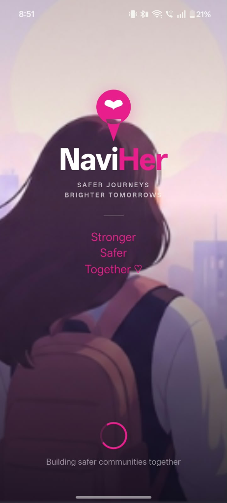
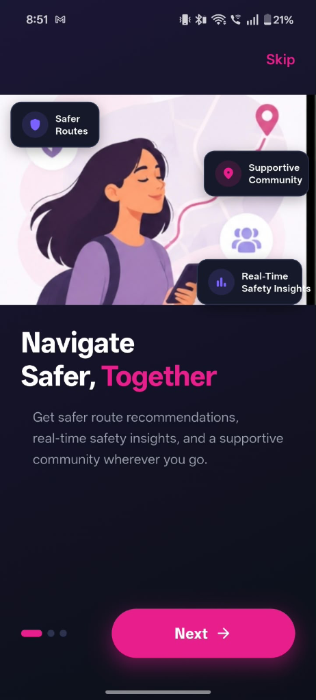
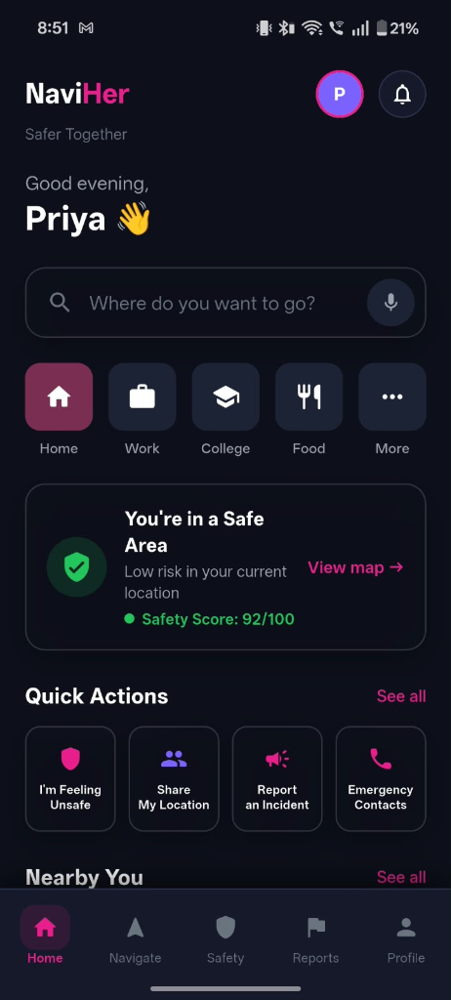
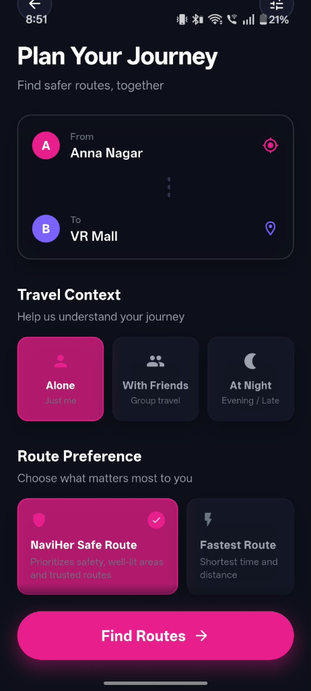
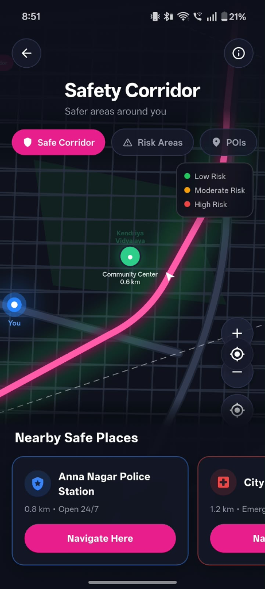
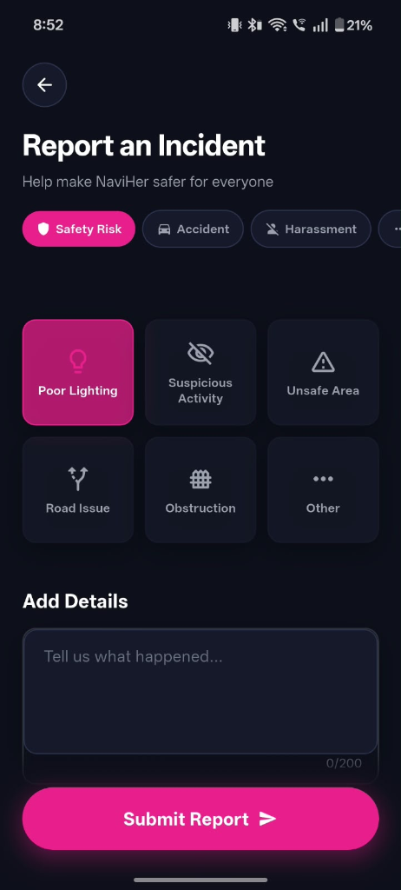
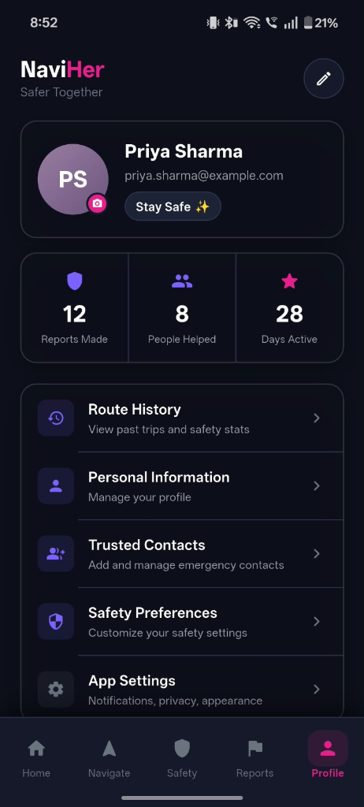
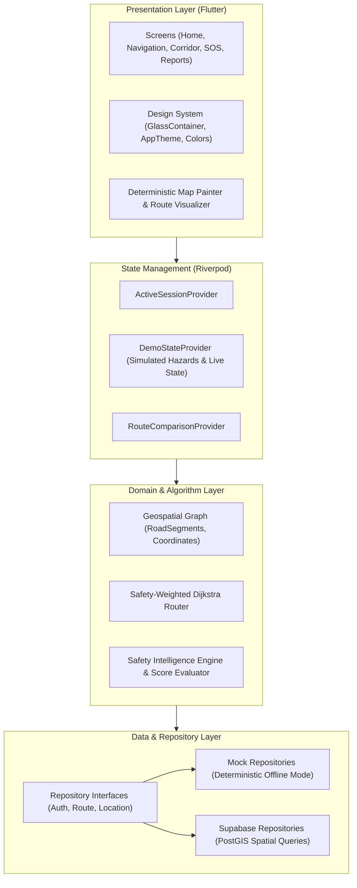

<div align="center">

# 🛡️ NaviHer AI

**Safety-First Intelligent Navigation & Emergency Response for Women**

[](https://flutter.dev)
[](https://dart.dev)
[](https://riverpod.dev)
[](https://supabase.com)
[](LICENSE)
[](CONTRIBUTING.md)

<p align="center">
  <b>NaviHer AI</b> rethinks navigation by prioritizing human safety over raw transit duration.
  <br>
  Traditional GPS apps route you through the fastest route—even if it leads down unlit back alleys or high-risk areas.
  <br>
  <b>NaviHer evaluates street lighting, foot-traffic density, safe-haven proximity, and real-time community incident reports to guide you along the safest paths.</b>
</p>

</div>

---

## 📱 App Preview

> All screenshots are from a real Android device.

| Splash | Onboarding | Home Dashboard |
|:---:|:---:|:---:|
|  |  |  |

| Plan Your Journey | Safety Corridor | Report an Incident |
|:---:|:---:|:---:|
|  |  |  |

| Profile & Stats | | |
|:---:|:---:|:---:|
|  | | |

---

## 🌟 Key Features

### 1. 🛣️ Safety vs. Speed Routing Engine
* **Multi-Factor Cost Optimization**: Instead of calculating purely by distance or travel time, NaviHer penalizes isolated road segments and rewards well-lit, populated thoroughfares.
* **Side-by-Side Comparison**: Visually compare the **Safest Route** against the **Fastest Route**, inspecting Safety Scores (0–100), lighting percentages, safe-haven density, and minor ETA trade-offs (e.g., +3 minutes for +35% higher safety).

### 2. 🟢 Safety Corridor & Safe Havens
* **Dynamic Safety Corridors**: Continuous visual boundary denoting well-monitored, secure travel corridors.
* **One-Tap Safe Place Rerouting**: Quick navigation to verified Points of Interest (POIs):
  - 👮 **Police Booths & Patrol Checkpoints**
  - 💊 **24/7 Verified Pharmacies**
  - 🚇 **Metro Stations & Transit Hubs**
  - 🏪 **Well-lit Convenience Stores**

### 3. 🚨 Emergency Mode (Simulated Prototype)
* **Intentional SOS Slider**: Prevents accidental triggers while allowing rapid activation under stress.
* **Simulated Live Location Broadcast**: Clear, real-time simulated location sharing banner with animated beacon indicators.
* **Emergency Contact Dispatch**: Mock SMS and alert broadcasts to pre-selected trusted contacts.

### 4. 📢 Crowdsourced Community Reporting
* **Real-Time Hazard Submission**: Report unlit streetlights, suspicious loitering, harassment, or blocked pathways.
* **Dynamic Feedback Loop**: Confirmed community reports immediately feed into the demo state, increasing hazard weights and dynamically rerouting active journeys.

### 5. 💎 Restrained Dark Glassmorphic Design System
* Engineered for night-time legibility without screen glare or battery drain.
* Semantic material hierarchy:
  - **`Pink` (Solid)**: High-priority primary actions and active route glow.
  - **`Blue` (Glass)**: Navigation information and secondary routes.
  - **`Green` (Glass)**: Safety confirmation and Safe Havens.
  - **`Neutral Navy` (Frosted Glass)**: Information cards, bottom sheets, and status controls with optimized contrast.

---

## 🧮 Mathematical Scoring Model

The safety score $S_e$ for a road segment $e$ is calculated dynamically:

$$S_e = \min\left(100, \max\left(0, B_e + w_l \cdot L_e + w_p \cdot P_e + w_a \cdot A_e - \sum_{h \in H_e} w_h \cdot C_h\right)\right)$$

Where:
* $B_e$ = Baseline street type score (e.g., Primary arterial vs. narrow alley)
* $L_e \in [0, 1]$ = Street lighting coverage
* $P_e \in [0, 1]$ = Proximity to verified Safe Havens (police booths, 24/7 commercial stores)
* $A_e \in [0, 1]$ = Historical foot-traffic and commercial activity index
* $H_e$ = Active crowdsourced hazards in segment proximity
* $C_h$ = Severity coefficient of hazard $h$

---

## 🏗️ System Architecture



---

## 📁 Project Structure

```
NaviHer/
├── .github/
│   └── workflows/
│       └── ci.yml               # Automated Flutter analysis & test runner
├── assets/
│   └── images/                  # Brand assets, logos & onboarding illustrations
├── docs/                        # Architectural specifications & QA audit reports
│   ├── GEOSPATIAL_ARCHITECTURE.md
│   ├── SUPABASE_ARCHITECTURE.md
│   └── ENVIRONMENT.md
├── lib/
│   ├── app/                     # App entry point & GoRouter configuration
│   ├── core/
│   │   ├── config/              # Environment flags (USE_SUPABASE toggle)
│   │   ├── models/              # Route, Hazard, SafePlace & Geospatial domain entities
│   │   ├── repositories/        # Abstract repositories & implementations
│   │   ├── services/            # Dijkstra routing & safety intelligence engines
│   │   └── theme/               # Colors, typography, shadows & radius tokens
│   ├── features/
│   │   ├── demo/                # In-memory reactive demo state provider
│   │   ├── emergency/           # Emergency SOS slider & simulated location sharing
│   │   ├── home/                # Main dashboard & quick destination cards
│   │   ├── navigation/          # Turn-by-turn navigation & route search
│   │   ├── onboarding/          # Splash & introduction carousel
│   │   ├── profile/             # Profile, safety preferences & trusted contacts
│   │   ├── reports/             # Community incident reporting flow
│   │   ├── route_comparison/    # Side-by-side Safe vs. Fastest comparison
│   │   ├── route_history/       # Completed journeys & safety stats
│   │   └── safety_corridor/     # Safety corridor exploration & POI safe havens
│   └── shared/
│       └── widgets/             # Reusable glassmorphic containers & navigation bars
├── screenshots/                 # High-resolution screenshots of the mobile prototype
├── supabase/
│   └── migrations/              # SQL PostGIS migrations for spatial queries
└── test/                        # Unit tests for routing, safety scoring & validation
```

---

## 🚀 Getting Started

### Prerequisites
* [Flutter SDK](https://docs.flutter.dev/get-started/install) (`>= 3.12.0`)
* Android Studio / VS Code with Flutter extension
* Android Emulator or physical device

### 1. Clone & Install
```bash
git clone https://github.com/<your-username>/NaviHer.git
cd NaviHer

# Fetch Flutter dependencies
flutter pub get
```

### 2. Run in Offline Prototype Mode (Default)
The app runs completely offline out-of-the-box with deterministic mock routing and simulated state:
```bash
flutter run
```

### 3. Run with Supabase PostGIS Backend (Optional)
If you wish to connect NaviHer to your own Supabase project:
1. Copy the environment template:
   ```bash
   cp .env.example .env
   ```
2. Open `.env` and fill in your Supabase project credentials:
   ```env
   USE_SUPABASE=true
   SUPABASE_URL=https://your-project-id.supabase.co
   SUPABASE_ANON_KEY=your_supabase_anon_key
   ```
3. Run the migrations in `supabase/migrations/` in your Supabase SQL editor.
4. Launch the application:
   ```bash
   ./run_supabase.sh
   # Or directly:
   flutter run --dart-define-from-file=.env
   ```

---

## 🧪 Testing & Verification

Run the test suite covering safety calculation formulas, coordinate conversions, and geospatial validations:

```bash
# Run static code analysis
flutter analyze

# Run unit and domain test suite
flutter test

# Build release APK
flutter build apk --release
```

---

## ⚠️ Prototype Disclaimer

> **IMPORTANT:**
> 1. **Prototype Simulation**: NaviHer AI is currently an active concept and research prototype. The emergency SOS broadcast and location sharing features are **internal software simulations** and do **NOT** dial local emergency dispatch (911/112) or broadcast real-world emergency SMS messages.
> 2. **Geospatial Scope**: The built-in deterministic demo routes utilize a calibrated Chennai road graph model to showcase mathematical route optimization without requiring commercial map API keys.

---

## 🤝 Contributing

Contributions, feedback, and discussions are welcome! Please check our [Contributing Guidelines](CONTRIBUTING.md) to get started.

1. Fork the repo
2. Create your feature branch: `git checkout -b feature/amazing-feature`
3. Commit your changes (`git commit -m 'feat: add amazing feature'`)
4. Push to the branch (`git push origin feature/amazing-feature`)
5. Open a Pull Request

---

## 📄 License

This project is open source and available under the [MIT License](LICENSE).

<div align="center">
  <sub>Built with ❤️ for a safer tomorrow.</sub>
</div>
